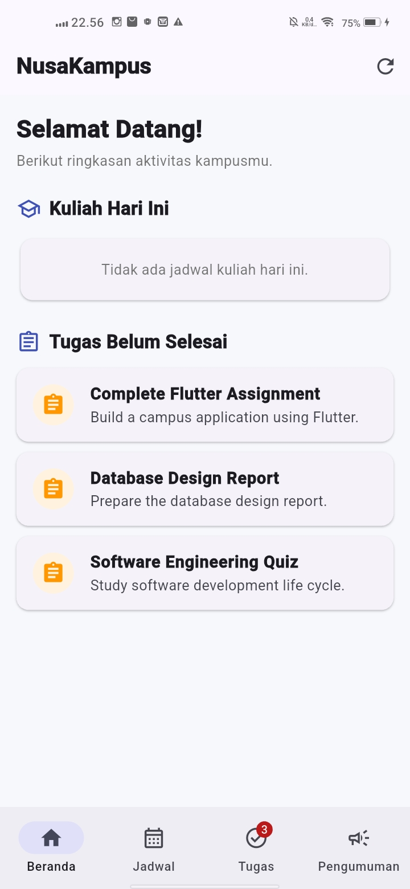
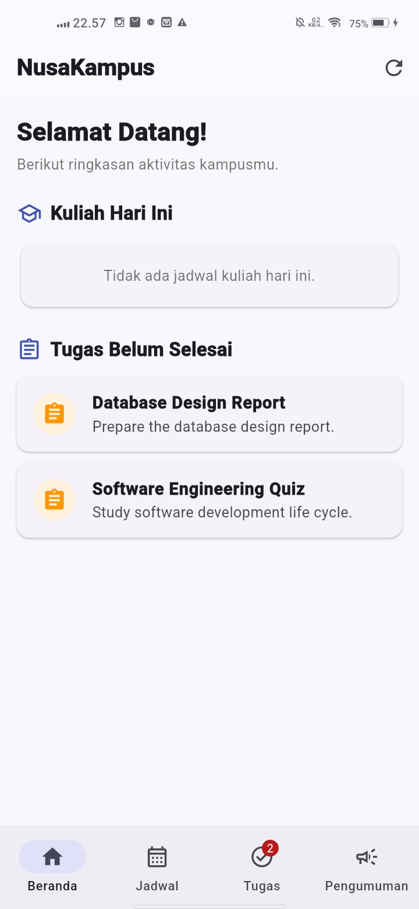
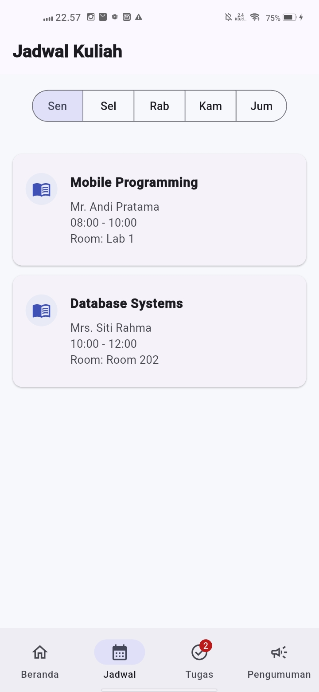
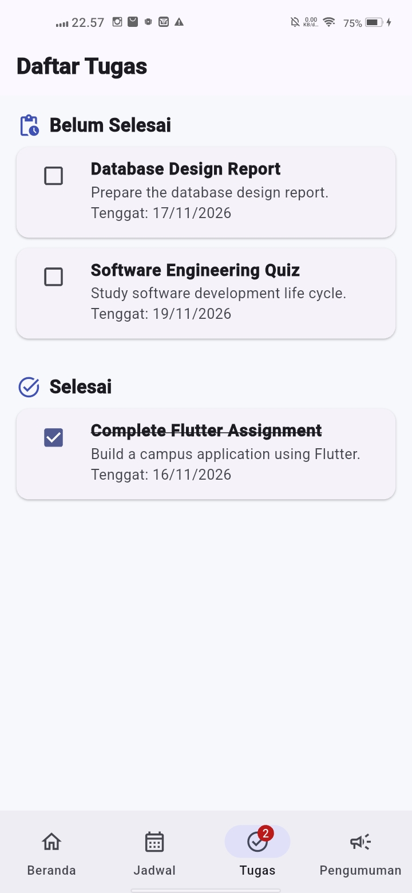

# NusaKampus

Aplikasi manajemen aktivitas mahasiswa berbasis Flutter.

## Deskripsi

NusaKampus merupakan aplikasi sederhana untuk membantu mahasiswa melihat jadwal kuliah, mengelola tugas, dan mendapatkan informasi pengumuman kampus.

## Teknologi

- Flutter
- Dart
- Provider
- ChangeNotifier
- Material 3

## Arsitektur

Aplikasi menggunakan arsitektur berlapis:

- View: menampilkan antarmuka aplikasi.
- ViewModel: mengelola state dan logika tampilan.
- Repository: mengelola akses data.
- Service: menyediakan data contoh sebagai simulasi server.

## Fitur Aplikasi

### 1. Beranda

Menampilkan jadwal kuliah hari ini dan tugas yang belum selesai.





### 2. Jadwal

Menampilkan jadwal kuliah dari Senin sampai Jumat menggunakan SegmentedButton.



### 3. Tugas

Menampilkan daftar tugas yang belum selesai dan sudah selesai. Tugas dapat ditandai menggunakan CheckboxListTile.



### 4. Pengumuman

Menampilkan daftar informasi dan pengumuman kampus.


## Struktur Folder

```text
lib/
├── main.dart
├── app.dart
├── config/
│   └── dependencies.dart
├── domain/
│   └── models/
├── data/
│   ├── services/
│   └── repositories/
└── ui/
    ├── core/
    ├── shell/
    ├── home/
    ├── schedule/
    ├── tasks/
    └── announcements/

test/
screenshots/
pubspec.yaml
```

## Menjalankan Aplikasi

Pastikan Flutter sudah terpasang, kemudian jalankan:

```bash
flutter pub get
flutter run
```

## Pengujian

Jalankan pengujian dengan perintah:

```bash
flutter test
```

Hasil pengujian: 2 test berhasil.

## Pengembang

Project ini dibuat untuk memenuhi tugas pengembangan aplikasi Flutter.
